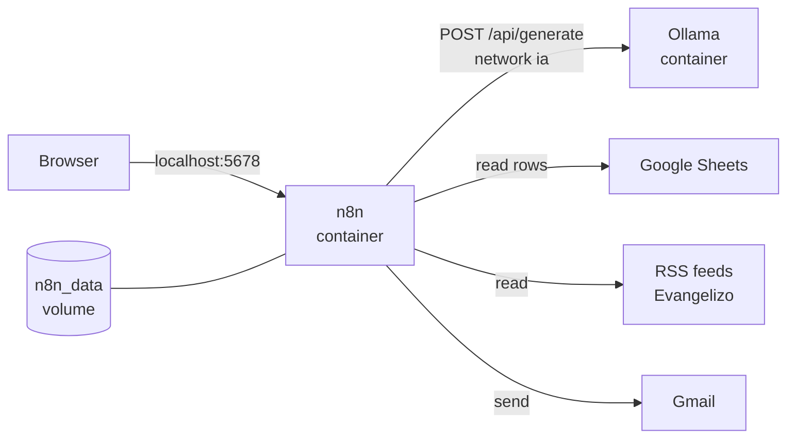

# lab-n8n

Self-hosted n8n automations with local AI: a daily news digest and a bilingual daily gospel email, driven by Google Sheets.

[](LICENSE)
[](https://n8n.io)
[](https://ollama.com)
[](https://docs.docker.com/compose/)

## What it is

A self-hosted [n8n](https://n8n.io) that writes with a local model in [Ollama](https://ollama.com), so no text is sent to an AI service.
Each project reads its users and settings from a Google Sheet and sends the result with Gmail.

- **News digest:** a daily email with each user's news from RSS feeds, summarised in their language and English level.
- **Daily gospel:** a daily email with the gospel of the day in English and Spanish, with a reflection and, when needed, a short apologetic note.

## Architecture



n8n and Ollama run in two containers on the Docker network `ia`.
Workflows and credentials live in the `n8n_data` volume, and users and settings in the Google Sheets.
More in [docs/architecture.md](docs/architecture.md).

## Quick start

With Docker running, from the repo root:

```bash
docker network create ia
docker compose up -d
```

Open http://localhost:5678 and create the owner account.
The projects also need Ollama and the Google credentials. The full path is in [docs/setup.md](docs/setup.md).

## Requirements

- Docker with the Compose plugin.
- An `ollama` container on the `ia` network, with `gemma4:12b` pulled. It works on CPU. A GPU makes it faster.
- A Google account for Google Sheets and Gmail.
- `jq`, only to export workflows back to the repo.

## Repository layout

- `docker-compose.yml`: the n8n container, shared by all projects.
- `docs/`: shared guides for setup, architecture and operations.
- `projects/<name>/`: one folder per project, with its own `README.md`, `workflows/` and `sheets/` templates.
- `specs/`: one spec per feature, numbered across all projects.

Credentials are never stored here. n8n keeps them encrypted in the `n8n_data` volume.

## Projects

| Project | Spec | Description |
| --- | --- | --- |
| [`projects/news-digest/`](projects/news-digest/README.md) | [SPEC 01](specs/01-daily-news-digest.md), [SPEC 04](specs/04-responsive-email-layout.md) | Daily news email for each user in a Google Sheet, from RSS feeds, summarised with Ollama in the user's language and English level. |
| [`projects/daily-gospel/`](projects/daily-gospel/README.md) | [SPEC 02](specs/02-daily-gospel-email.md), [SPEC 03](specs/03-gospel-apologetic-note.md), [SPEC 04](specs/04-responsive-email-layout.md) | Daily email with the Catholic gospel of the day in English and Spanish, a two-line apologetic note on the days the passage needs it, and a question-and-answer reflection written with Ollama for each group's language, level and audience. |

## How the repo is built

Every change starts as a spec in [`specs/`](specs/), numbered across all projects (`01`, `02`, …).
A spec says what is in and out of scope, the data model, the implementation plan and the acceptance criteria.
It moves through the states `Draft`, `In review`, `Approved` and `Implemented`, and is built on its own branch, `spec-NN-slug`, only once it is `Approved`.

## Documentation

- [Setup](docs/setup.md): Docker, n8n, Ollama and the Google credentials, step by step.
- [Architecture](docs/architecture.md): containers, where state lives, and how each workflow runs.
- [Operations](docs/operations.md): import and export workflows, backups, updates and troubleshooting.
- [News digest](projects/news-digest/README.md): sheet, workflow and daily use.
- [Daily gospel](projects/daily-gospel/README.md): sheet, workflow and daily use.

## License

[MIT](LICENSE) © 2026 Juan Manuel Velez Parra
