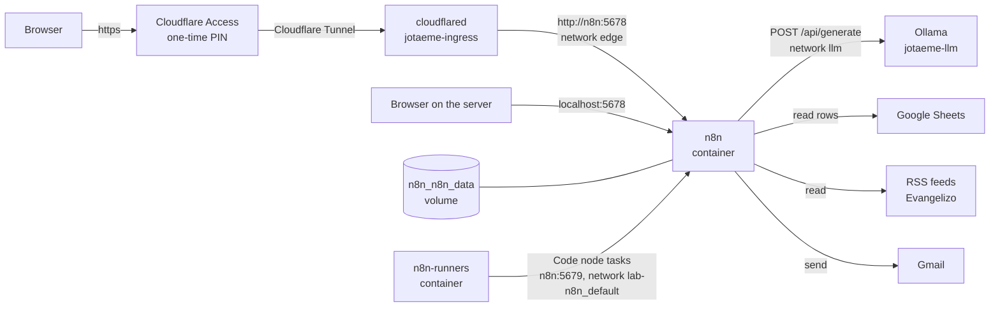
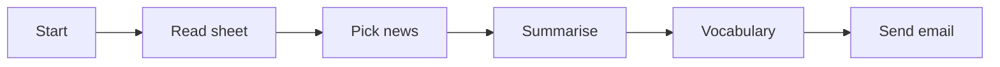
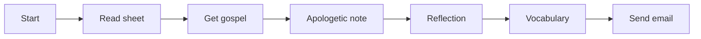

# Architecture

How the stack is built: the containers, where the state lives, and how each workflow goes from its trigger to a sent email.
To install it, see the [setup guide](setup.md).

## Containers

Four containers run on the same host.
This repo starts two of them, `n8n` and `n8n-runners`, in the Compose project `lab-n8n`.
`cloudflared` and `ollama` come from their own repos and reach n8n over shared Docker networks.

| Container | Image | Started from | Port on the host | Role |
| --- | --- | --- | --- | --- |
| `n8n` | `docker.n8n.io/n8nio/n8n` | `docker-compose.yml` in this repo | `5678`, on `127.0.0.1` only | Runs the workflows and the editor, at `https://lab-n8n.jotaeme.dev` and at http://localhost:5678 on the server. |
| `n8n-runners` | `n8nio/runners`, same tag as `n8n` | `docker-compose.yml` in this repo | None | Runs the code of the Code nodes. It takes each task from n8n's task broker at `http://n8n:5679`, authenticated with `N8N_RUNNERS_AUTH_TOKEN` from `.env`. |
| `cloudflared` | `cloudflare/cloudflared` | [jotaeme-ingress](https://github.com/JuanMaVelezPa/jotaeme-ingress) | None | Opens the Cloudflare Tunnel and forwards `lab-n8n.jotaeme.dev` to `http://n8n:5678`. |
| `ollama` | `ollama/ollama` | [jotaeme-llm](https://github.com/JuanMaVelezPa/jotaeme-llm) | `11434`, on `127.0.0.1` only | Runs the language model. |

The containers reach each other by name over three Docker networks, each with one role:

| Network | Created by | Members | Used for |
| --- | --- | --- | --- |
| `lab-n8n_default` | Compose, for the project `lab-n8n` | `n8n`, `n8n-runners` | `n8n-runners` takes tasks from the broker at `http://n8n:5679`. |
| `edge` | `docker network create edge`, once on the host | `n8n`, `cloudflared` | `cloudflared` forwards requests to `http://n8n:5678`. |
| `llm` | `docker network create llm`, once on the host | `n8n`, `ollama` | n8n calls the model at `http://ollama:11434`. |

The broker port `5679` is not published on the host and is reachable only on `lab-n8n_default`, so only `n8n-runners`, with the token, can take tasks.
`n8n-runners` is on no other network: it needs only the broker.
`edge` and `llm` are marked `external` in every compose file that uses them, so no stack deletes them on `down`.



## Remote access

The editor is published at `https://lab-n8n.jotaeme.dev`.
The request reaches Cloudflare, where Access asks for an email and sends a one-time PIN to the one allowed address.
Only after the PIN does Cloudflare send it down the tunnel to `cloudflared`, which forwards it to n8n.
n8n then asks for its own owner login, so there are two layers.

- The tunnel is outbound from `cloudflared`, so no port is opened on the router.
- Access covers the whole hostname, webhook paths included.
- n8n binds to `127.0.0.1:5678`, so other devices on the LAN cannot skip Access by using the server IP.
- `N8N_HOST`, `N8N_PROTOCOL`, `N8N_EDITOR_BASE_URL` and `N8N_WEBHOOK_URL` make n8n build its OAuth and webhook URLs with the public hostname.
- `N8N_PROXY_HOPS=1` makes n8n trust the proxy headers from `cloudflared`, and `N8N_SECURE_COOKIE=true` keeps the session cookie HTTPS only.

The schedules do not depend on the tunnel.
If Cloudflare or the tunnel is down, the workflows still run and the editor is still at http://localhost:5678 on the server.
The setup steps are in the [setup guide](setup.md#cloudflare-tunnel-and-access).

## Time zone

n8n runs in `America/Bogota` (`TZ` and `GENERIC_TIMEZONE` in `docker-compose.yml`).
Schedules, `send_hour` and the dates in the emails use that time zone.

## Where state lives

| What | Where |
| --- | --- |
| Workflows as they run, executions, credentials (encrypted) and the encryption key | The `n8n_n8n_data` volume, mounted at `/home/node/.n8n`. Its name is fixed in `docker-compose.yml`, so it keeps the name from the old Compose project `n8n`. |
| Users, topics, feeds, recipients and settings | One Google Sheet per project. |
| The language model | The volume of the `ollama` container. |
| Workflow definitions, sheet templates, docs and specs | This repo. |

The repo holds no state of a running install.
The workflow files have the placeholder `<Google Sheet document ID>` and refer to the credentials by name only.
Real addresses live only in the sheets, and credentials only in the volume.
See [operations](operations.md#back-up-and-restore-n8n) to back up the volume.

## How the model is called

Every AI step is an n8n **HTTP Request** node that sends `POST /api/generate` to `http://ollama:11434` (the `ollamaUrl` value of the `Settings` node).
The request body is built in a Code node before the call:

```json
{ "model": "gemma4:12b", "prompt": "...", "format": "json", "stream": false, "think": false }
```

- `model` is the value of `ollama_model` in the `Config` tab of the project's sheet.
- `format: "json"` makes the model answer with a JSON object, which the next Code node parses.
- The calls run one at a time, through a loop node, so Ollama handles one prompt at a time.
- Each call has a timeout and continues on error. A failed call or an answer that is not valid JSON leaves that part out of the email, as described in each project's "When something fails" section.

## How Google and feed calls are retried

Short network drops to Google and to the feeds are retried before a run fails.
The Google Sheets reads, `Sender` and the feed nodes are set to n8n's built-in retry: 5 tries, 5 s apart.
The Google nodes (the Sheets reads, `Sender` and `Send Email`) also have a fallback loop on their error output: an If node `Retry <Node>?` and a Wait node `Wait <Node>` that run the node again after 1 minute, in up to 2 rounds.
The wait and the number of rounds are the `retryWaitSeconds` and `retryRounds` values of the `Settings` node.
When the rounds are used up, the `Retries Exhausted` node stops the run with the original error, so it shows in **Executions**.

- The built-in retry does not fire on the Google Sheets nodes while they use the error output, because n8n 3.2.0 sees their error only on the item and not in `json.error`. Those nodes rely on the 1-minute rounds.
- `Send Email` has no built-in retry, because it would re-send every email of the run. Its error output carries only the failed emails, so the loop re-sends only those.
- The feed nodes keep "continue on error": a feed that still fails after its tries is left out of the email.

## News digest

Six groups of nodes, the same as the sticky notes in the n8n editor, from the trigger to the sent email.
The node names and what each group does are in the [project README](../projects/news-digest/README.md#how-it-works).



## Daily gospel

Seven groups of nodes, the same as the sticky notes in the n8n editor, from the trigger to the sent email.
The node names and what each group does are in the [project README](../projects/daily-gospel/README.md#how-it-works).


