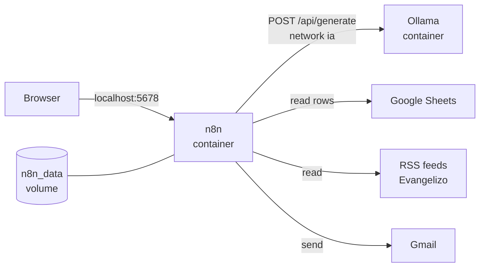
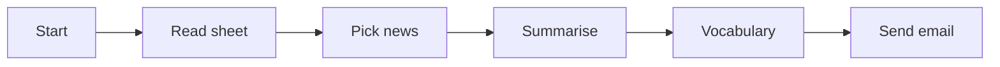
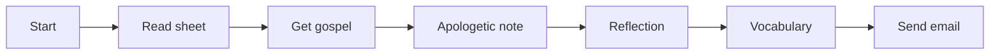

# Architecture

How the stack is built: the containers, where the state lives, and how each workflow goes from its trigger to a sent email.
To install it, see the [setup guide](setup.md).

## Containers

Two containers run on the same host and talk over an external Docker network named `ia`.

| Container | Image | Started from | Port on the host | Role |
| --- | --- | --- | --- | --- |
| `n8n` | `docker.n8n.io/n8nio/n8n` | `docker-compose.yml` in this repo | `5678`, on every interface | Runs the workflows and the editor at http://localhost:5678. |
| `ollama` | `ollama/ollama` | Its own compose file, outside this repo | `11434`, on `127.0.0.1` only | Runs the language model. |

n8n reaches Ollama by container name, at `http://ollama:11434`, through the `ia` network.
The network is created once with `docker network create ia` and is marked `external` in both compose files, so neither of them deletes it.



n8n runs in `America/Bogota` (`TZ` and `GENERIC_TIMEZONE` in `docker-compose.yml`).
Schedules, `send_hour` and the dates in the emails use that time zone.

## Where state lives

| What | Where |
| --- | --- |
| Workflows as they run, executions, credentials (encrypted) and the encryption key | The `n8n_data` volume, mounted at `/home/node/.n8n`. |
| Users, topics, feeds, recipients and settings | One Google Sheet per project. |
| The language model | The volume of the `ollama` container. |
| Workflow definitions, sheet templates, docs and specs | This repo. |

The repo holds no state of a running install.
The workflow files have the placeholder `<Google Sheet document ID>` and refer to the credentials by name only.
Real addresses live only in the sheets, and credentials only in the volume.
See [operations](operations.md#back-up-and-restore-n8n) to back up the volume.

## How the model is called

Every AI step is an n8n **HTTP Request** node that sends `POST /api/generate` to `http://ollama:11434` (the `ollamaUrl` value of the `Settings` node).
The request body is built in a Code node before the call:

```json
{ "model": "gemma4:12b", "prompt": "...", "format": "json", "stream": false, "think": false }
```

- `model` is the value of `ollama_model` in the `Config` tab of the project's sheet.
- `format: "json"` makes the model answer with a JSON object, which the next Code node parses.
- The calls run one at a time, through a loop node, so Ollama handles one prompt at a time.
- Each call has a timeout and continues on error. A failed call or an answer that is not valid JSON leaves that part out of the email, as described in each project's "When something fails" section.

## News digest

Six groups of nodes, the same as the sticky notes in the n8n editor, from the trigger to the sent email.
The node names and what each group does are in the [project README](../projects/news-digest/README.md#how-it-works).



## Daily gospel

Seven groups of nodes, the same as the sticky notes in the n8n editor, from the trigger to the sent email.
The node names and what each group does are in the [project README](../projects/daily-gospel/README.md#how-it-works).


